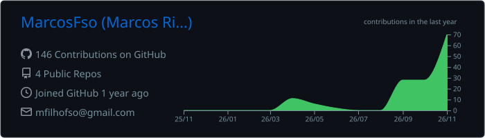
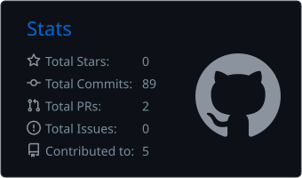
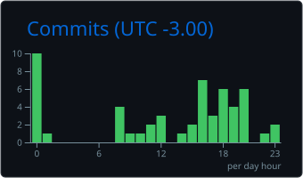

  

<h2 align="center">Olá! Eu sou o Marcos Ribeiro 👋</h2>

  

  Estudante de Sistemas de Informação na Uniube (Uberlândia - MG). 
  Já coloquei em produção dois sistemas web para empresas, com CI/CD, testes automatizados, backup diário e monitoramento.

 

<h3 align="center">Tech Stack &amp; Tools</h3>

  

<h3 align="center">Projetos em destaque</h3>

<ul>
  <li>💸 <b><a href="https://github.com/MarcosFso/cobraai">CobraAí</a></b> (<a href="https://cobraai-wake.vercel.app">demo ao vivo</a>): sistema de cobranças para pequenas empresas, feito como arquitetura de microsserviços orientada a eventos. Serviços em Java (Spring Boot), Python (FastAPI) e Node.js conversam por eventos do Kafka, com outbox transacional e consumidores idempotentes. Front-end em React e TypeScript, PostgreSQL e Redis, tudo em Docker, no ar na Azure com HTTPS e CI no GitHub Actions. Cerca de 140 testes automatizados.</li>
  <li>🌿 <b><a href="https://github.com/MarcosFso/verde-prime">Verde Prime</a></b> (<a href="https://verde-prime.vercel.app">online</a>): sistema de fichas técnicas para empresa de consultoria ambiental. React, TypeScript, Vite, PWA e Supabase (PostgreSQL, Auth e Storage), com Row Level Security, recibos em PDF, 39 testes (Vitest) e CI/CD com GitHub Actions.</li>
  <li>🗺️ <b>Agro Ambiental</b>: sistema de protocolos de georreferenciamento em produção. JavaScript, Vite, API serverless em Node.js na Vercel e Supabase, com 72 testes automatizados, backup diário e monitoramento a cada 3 horas. <i>(código privado)</i></li>
  <li>🚗 <b><a href="https://github.com/MarcosFso/SpeedVision">SpeedVision</a></b>: simulação de radar eletrônico que estima a velocidade de veículos em vídeos de rodovias. Python, OpenCV, YOLO e interface web. <i>(projeto em equipe da faculdade)</i></li>
</ul>

  

  
  

  
  
  

